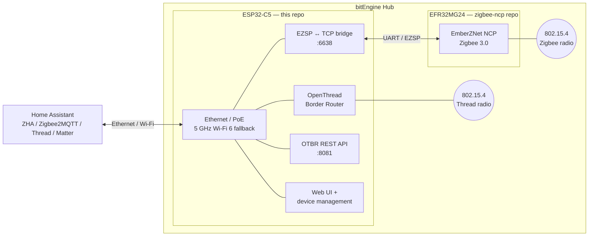

# bitEngine Hub — ESP32-C5 firmware

Application firmware and embedded web UI for the **bitEngine Hub**, an open, PoE-powered
Zigbee 3.0 + Thread gateway for Home Assistant.

> **Status: pre-release.** The source code will be published in this repository under the
> Apache License 2.0 in **November 2026**, ahead of the Crowd Supply campaign. Until then this
> repository holds the architecture, integration documentation and roadmap, so that what is
> coming is visible before it lands.

- Product page and newsletter: <https://home.bitengine.tech>
- Dev-log and feedback thread on the Home Assistant Community forum:
  <https://community.home-assistant.io/t/1028644>
- Zigbee NCP (EFR32MG24) firmware: [bitengine-hub-zigbee-ncp](https://github.com/bitEngineTech/bitengine-hub-zigbee-ncp)
- Hardware (schematics, enclosure): [bitengine-hub-hardware](https://github.com/bitEngineTech/bitengine-hub-hardware)

## What the hub does

The hub runs Zigbee and Thread **at the same time, on two independent radios**, and connects to
your network over one Ethernet cable with 802.3af PoE. 5 GHz Wi-Fi 6 is available as an
alternative uplink; 2.4 GHz Wi-Fi is kept off so that band stays clear for Zigbee and Thread.

- **ESP32-C5** (this repository): Thread border router (OpenThread, running *on the device* — no
  Home Assistant add-on needed), Wi-Fi / Ethernet networking, EZSP bridge for the Zigbee radio,
  device management and the web UI.
- **EFR32MG24** ([bitengine-hub-zigbee-ncp](https://github.com/bitEngineTech/bitengine-hub-zigbee-ncp)):
  Zigbee 3.0 coordinator running Silicon Labs EmberZNet as an NCP, connected to the ESP32-C5 over
  UART.

Home Assistant sees two standard interfaces, both served by the ESP32-C5:

| Service | Port | Used by |
|---|---|---|
| EZSP over TCP (Zigbee coordinator) | `6638/tcp` | ZHA (`socket://<hub-ip>:6638`), Zigbee2MQTT (`tcp://<hub-ip>:6638`, `adapter: ember`) |
| OpenThread Border Router REST API | `8081/tcp` | Home Assistant *Open Thread Border Router* integration |
| Web UI | HTTP | Status, network settings, firmware updates |

No proprietary host software or cloud service is involved.

## Architecture



Thread and Zigbee run on separate 802.15.4 channels, each on its own radio and antenna, so one
network does not have to share airtime with the other.

## Repository layout (planned)

```
main/          ESP-IDF application (networking, OTBR, EZSP bridge, updater, LEDs)
components/    Project-local components
www/           Embedded web UI (built and embedded into the firmware image)
docs/          User and integration documentation
tools/         Build, signing and release helpers
```

The web UI lives in the same repository as the firmware on purpose: it is compiled into the
firmware image and shares its API, so the two are always released together.

## Building

Build instructions, the pinned ESP-IDF version and the release process will be published with
the source. The ESP32-C5 image is built from this repository plus upstream open-source
components only (ESP-IDF, OpenThread), so the complete image can be rebuilt from source.

## Firmware updates and user freedom

- Official images are **signed** so that updates can be verified.
- The ESP32-C5 **secure-boot and flash-encryption eFuses are not burned**. Both MCUs stay fully
  user-flashable: you can build, sign and run your own firmware on the hardware you bought.
- See [docs/flashing.md](docs/flashing.md).

## Documentation

- [Home Assistant integration (ZHA, Zigbee2MQTT, Thread / Matter)](docs/home-assistant.md)
- [Flashing and recovery](docs/flashing.md)

## Roadmap

| When | What |
|---|---|
| Oct 2026 | Public dev-log and feedback collection; validation with Zigbee2MQTT and current Home Assistant releases (in progress — ZHA is tested) |
| Nov 2026 | Source release under Apache-2.0 with build instructions; first signed release images |
| After source release | Submission to the Zigbee2MQTT and ZHA supported-adapter lists |
| Dec 2026 (target) | Crowd Supply campaign launch |

## License

Copyright 2026 bitEngine, Inc.

Licensed under the Apache License, Version 2.0 — see [LICENSE](LICENSE) and [NOTICE](NOTICE).
Built on [ESP-IDF](https://github.com/espressif/esp-idf) (Apache-2.0) and
[OpenThread](https://github.com/openthread/openthread) (BSD-3-Clause).

The Zigbee radio firmware is covered separately in
[bitengine-hub-zigbee-ncp](https://github.com/bitEngineTech/bitengine-hub-zigbee-ncp); the
hardware is released under CERN-OHL-P v2 in
[bitengine-hub-hardware](https://github.com/bitEngineTech/bitengine-hub-hardware).
