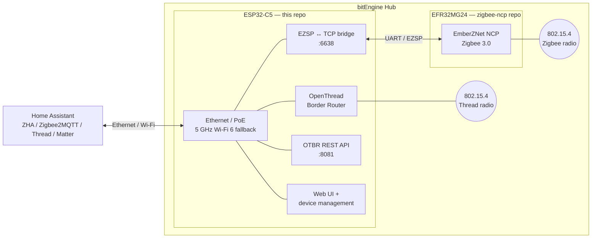

# bitEngine Hub — ESP32-C5 firmware

Application firmware and embedded web UI for the **bitEngine Hub**, an open, PoE-powered
Zigbee 3.0 + Thread gateway for Home Assistant.

> **Status: pre-release.** The complete source of the ESP32-C5 firmware and web UI is published
> here under the Apache License 2.0. Hardware is at the prototype stage; signed release images
> follow on the Releases page.

- Product page and newsletter: <https://home.bitengine.tech>
- Dev-log and feedback thread on the Home Assistant Community forum:
  <https://community.home-assistant.io/t/1028644>
- Zigbee NCP (EFR32MG24) firmware: [bitengine-hub-zigbee-ncp](https://github.com/bitEngineTech/bitengine-hub-zigbee-ncp)
- Hardware (schematics, enclosure): [bitengine-hub-hardware](https://github.com/bitEngineTech/bitengine-hub-hardware)

## What the hub does

The hub runs Zigbee and Thread **at the same time, on two independent radios**, and connects to
your network over one Ethernet cable with 802.3af PoE. 5 GHz Wi-Fi 6 is available as an
alternative uplink; 2.4 GHz Wi-Fi is kept off so that band stays clear for Zigbee and Thread.

- **ESP32-C5** (this repository): Thread border router (OpenThread, running *on the device* — no
  Home Assistant add-on needed), Wi-Fi / Ethernet networking, EZSP bridge for the Zigbee radio,
  device management and the web UI.
- **EFR32MG24** ([bitengine-hub-zigbee-ncp](https://github.com/bitEngineTech/bitengine-hub-zigbee-ncp)):
  Zigbee 3.0 coordinator running Silicon Labs EmberZNet as an NCP, connected to the ESP32-C5 over
  UART.

Home Assistant sees two standard interfaces, both served by the ESP32-C5:

| Service | Port | Used by |
|---|---|---|
| EZSP over TCP (Zigbee coordinator) | `6638/tcp` | ZHA (`socket://<hub-ip>:6638`), Zigbee2MQTT (`tcp://<hub-ip>:6638`, `adapter: ember`) |
| OpenThread Border Router REST API | `8081/tcp` (also on `80`) | Home Assistant *Open Thread Border Router* integration |
| Web UI and REST API | `80/tcp` | Status, network settings, firmware updates — [docs/web-api.md](docs/web-api.md) |

No proprietary host software or cloud service is involved.

## Architecture



Thread and Zigbee run on separate 802.15.4 channels, each on its own radio and antenna, so one
network does not have to share airtime with the other.

## Product profiles

The same source builds two firmware images, selected at compile time:

- **HA profile** (`bitengine`, the default and the released firmware): the bridge described
  above, for Home Assistant (ZHA / Zigbee2MQTT) over Ethernet or 5 GHz Wi-Fi.
- **Direct profile** (`bitengine-direct`, **under development**): the hub is itself the
  Zigbee host and a Matter controller, and links to Meta's Muse through the open-source
  [Muse Gadget SDK](https://github.com/facebookincubator/muse-gadget-sdk). Ethernet only. See
  [docs/direct-profile.md](docs/direct-profile.md).

## Repository layout

```
main/            ESP-IDF application entry point and Kconfig (profile selection)
components/      Project components: EZSP bridge, networking, Thread border router, OTA,
                 web server and REST API, watchdog, LEDs, MQTT / webhook, Direct-profile stack, ...
frontend/        Web UI sources (plain JavaScript; built into the www partition by the firmware build)
ha_integration/  Optional Home Assistant custom integration for the hub's own health and controls
mg24/            Git submodule: EFR32MG24 Zigbee NCP firmware (bitengine-hub-zigbee-ncp)
tools/           Build, signing, patching, release and test helpers
docs/            Documentation
```

The web UI lives in the same repository as the firmware on purpose: it is built into the
firmware image and shares its API, so the two are always released together.

## Building

```bash
git clone --recursive https://github.com/bitEngineTech/bitengine-hub-firmware.git
cd bitengine-hub-firmware
source <path-to-esp-idf-v6.0.2>/export.sh
idf.py build                       # HA profile -> build/bitengine.bin, build/www.bin
idf.py -p /dev/ttyACM0 flash       # over the hub's USB-C port
```

ESP-IDF **v6.0.2** is required. The image is built from this repository plus upstream
open-source components only (ESP-IDF, OpenThread, Espressif managed components); building this
repository reproduces the released application byte for byte, apart from build timestamps,
hashes and the version string. Details, the Direct profile and the tests:
[docs/building.md](docs/building.md).

## Firmware updates and user freedom

- Official images are **signed** so that updates can be verified.
- The ESP32-C5 **secure-boot and flash-encryption eFuses are not burned**. Both MCUs stay fully
  user-flashable: you can build, sign with your own key and run your own firmware on the
  hardware you bought. The first build generates a development key for you.
- See [docs/flashing.md](docs/flashing.md).

## Documentation

- [Home Assistant integration (ZHA, Zigbee2MQTT, Thread / Matter)](docs/home-assistant.md)
- [Building and testing](docs/building.md)
- [Flashing, updates and recovery](docs/flashing.md)
- [Firmware architecture](docs/architecture.md)
- [Web / REST API](docs/web-api.md)
- [Direct profile](docs/direct-profile.md)

Source comments and component notes (`VERIFY.sh`, `CHECKLIST.md`, `UPSTREAM.md`) are largely
in Chinese and refer to internal design documents that are not part of this repository; the
documents above are the public reference.

## Roadmap

| When | What |
|---|---|
| Oct 2026 | Public dev-log and feedback collection; ZHA and Zigbee2MQTT tested; source release under Apache-2.0 with build instructions |
| Nov 2026 | First signed release images; validation on current Home Assistant releases |
| After source release | Submission to the Zigbee2MQTT and ZHA supported-adapter lists |
| Dec 2026 (target) | Crowd Supply campaign launch |

## License

Copyright 2026 bitEngine, Inc.

Licensed under the Apache License, Version 2.0 — see [LICENSE](LICENSE) and [NOTICE](NOTICE).
Built on [ESP-IDF](https://github.com/espressif/esp-idf) (Apache-2.0) and
[OpenThread](https://github.com/openthread/openthread) (BSD-3-Clause); third-party material is
listed in [NOTICE](NOTICE).

The Zigbee radio firmware is covered separately in
[bitengine-hub-zigbee-ncp](https://github.com/bitEngineTech/bitengine-hub-zigbee-ncp); the
hardware is released under CERN-OHL-P v2 in
[bitengine-hub-hardware](https://github.com/bitEngineTech/bitengine-hub-hardware).
